  

  
  
  
  
  
  

---

# ⚡ Awesome Event Bus & Pub/Sub Messaging

A curated, comprehensive guide and directory of enterprise **SaaS platforms**, cloud services, and **open-source projects** for **Event Bus, Publish-Subscribe (Pub/Sub), Event Streaming, and Message Broker** architectures.

Whether you are designing decoupled microservices, orchestrating transactional outboxes, routing real-time WebSockets, or scaling distributed streaming pipelines, this guide tracks category leaders, pricing structures, free tier allocations, and open-source alternatives.

---

## 📑 Table of Contents

- [⚡ Awesome Event Bus & Pub/Sub Messaging](#-awesome-event-bus--pubsub-messaging)
  - [📑 Table of Contents](#-table-of-contents)
  - [📊 Sector Overview & Market Dynamics](#-sector-overview--market-dynamics)
  - [☁️ SaaS & Hosted Platforms](#️-saas--hosted-platforms)
  - [💻 Open-Source GitHub Projects](#-open-source-github-projects)
    - [1. Redis](#1-redis-)
    - [2. Apache Kafka](#2-apache-kafka-)
    - [3. Dapr](#3-dapr-)
    - [4. Apache RocketMQ](#4-apache-rocketmq-)
    - [5. NATS Server](#5-nats-server-)
    - [6. EMQX](#6-emqx-)
    - [7. Apache Pulsar](#7-apache-pulsar-)
    - [8. RabbitMQ Server](#8-rabbitmq-server-)
    - [9. Redpanda](#9-redpanda-)
    - [10. Eclipse Mosquitto](#10-eclipse-mosquitto-)
    - [11. ZeroMQ (libzmq)](#11-zeromq-libzmq-)
    - [12. Centrifugo](#12-centrifugo-)
    - [13. Watermill](#13-watermill-)
    - [14. MQTT.js](#14-mqttjs-)
    - [15. Soketi](#15-soketi-)
    - [16. EventBus (Go)](#16-eventbus-go-)
    - [17. Outpost (Hookdeck)](#17-outpost-hookdeck-)
    - [18. Ripple](#18-ripple-)
    - [19. Event (Go Library)](#19-event-go-library-)
  - [🧩 Architectural Taxonomy & Comparison](#-architectural-taxonomy--comparison)
  - [⭐ Star History](#-star-history)
  - [🤝 How to Contribute](#-how-to-contribute)
  - [🛡️ Disclaimer & Architectural Considerations](#️-disclaimer--architectural-considerations)

---

## 📊 Sector Overview & Market Dynamics

The global message broker, event streaming, and event-driven architecture (EDA) software market is estimated at **$4.8B – $5.2B in 2025–2026**, expanding at a compound annual growth rate (**CAGR) of ~11.9%** and projected to exceed **$13.2B by 2034**, with the broader cloud application integration and event-driven middleware ecosystem surpassing **$25B**.

The sector exhibits **moderate fragmentation** characterized by a dual-tier structure rather than a pure winner-take-all monopoly: while cloud hyperscalers (AWS, Microsoft Azure, Google Cloud) capture massive volume in managed serverless event routing, high-performance distributed streaming and multi-cloud infrastructure remain fiercely competitive and protocol-diverse across independent leaders (Apache Kafka/Confluent, Redpanda, Solace, RabbitMQ, NATS) driven by multi-cloud flexibility, on-premise deployments, and edge/IoT messaging demands.

---

## ☁️ SaaS & Hosted Platforms

The table below catalogs premier hosted pub/sub and event bus services, sorted in **descending order by company scale** (market capitalization or private valuation).

| 🏢 Provider & Service | 📈 Company Scale (Valuation / Revenue) | ⚙️ Architecture & Protocols | 💳 Starting Tier Pricing | 🎁 Free Tier & Trial Limits |
| :--- | :--- | :--- | :--- | :--- |
| **[Azure Event Grid](https://azure.microsoft.com/en-us/products/event-grid/)**  *(Microsoft)* | **~$3.1 Trillion Market Cap**  (~$245B Ann. Revenue) | Serverless reactive event routing, CloudEvents 1.0, MQTT v5.0 broker, HTTP Push/Pull | **$0.60 per million operations** (Basic push topics); **$0.40 per million operations** (Standard namespace pull / MQTT) | **100,000 operations/month free forever** (Basic tier) + **1,000,000 MQTT operations/month free** (Standard namespace) |
| **[Google Cloud Pub/Sub](https://cloud.google.com/pubsub)**  *(Google / Alphabet)* | **~$2.1 Trillion Market Cap**  (~$350B Ann. Revenue) | Global distributed messaging service, at-least-once & exactly-once delivery, gRPC/REST, push/pull | **$40.00 per TiB throughput** (~$0.039 per GiB) beyond free monthly quota | **10 GiB throughput/month free forever** + **first 24h message storage free** + $300 new customer credits valid for 90 days |
| **[AWS EventBridge](https://aws.amazon.com/eventbridge/)**  *(Amazon Web Services)* | **~$2.0 Trillion Market Cap**  (~$620B Ann. Revenue; AWS ~$105B ARR) | Serverless event bus & routing engine, declarative filtering, schema registry, 45+ SaaS partner sources | **$1.00 per million custom events ingested**; **$0.40 per million requests** (EventBridge Pipes) | **100% free forever for all AWS Service Management Events**; **14,000,000 Scheduler invocations/month free forever**; **5,000,000 schema discovery events/month free** |
| **[Salesforce Event Bus](https://developer.salesforce.com/docs/platform/pub-sub-api/guide/expanded-event-bus.html)**  *(Salesforce)* | **~$280 Billion Market Cap**  (~$38B Ann. Revenue) | Multi-cloud event log, gRPC Pub/Sub API, Apache Avro schemas, Change Data Capture (CDC), Event Relay to AWS | **$165/user/month** (Enterprise Edition) or **$250/month** for High-Volume Event Add-on packs (100k events/day) | **10,000 event deliveries per 24-hour rolling window free forever** in Developer Edition; 72-hour historical event replay buffer included |
| **[Confluent Cloud](https://www.confluent.io/confluent-cloud/)**  *(Confluent / Apache Kafka)* | **~$8.5 Billion Market Cap**  (~$960M Ann. Revenue) | Fully managed Apache Kafka streaming data service, KStreams, Flink SQL, Schema Registry, 120+ managed connectors | **$0.00 base cluster fee** (Basic Serverless: $0.13/GB ingress, $0.13/GB egress, $0.10/GB-month storage, $0.0015/partition-hour) | **30-day free trial with $400 usage credits**; Stream Governance Essentials tier **free forever** (up to 100 schemas, 10 exporters) |
| **[Pusher Channels](https://pusher.com/)**  *(Bird / MessageBird)* | **~$3.8 Billion Valuation**  (~$600M Ann. Revenue) | Hosted real-time WebSocket pub/sub messaging engine, presence channels, webhooks, bi-directional event distribution | **$49/month** (Startup Plan: 1,000,000 messages/day, 500 concurrent connections, SSL included) | **Sandbox Plan free forever**: **200,000 messages/day** (~6M msgs/month) and **100 concurrent connections** |
| **[Redpanda Cloud](https://www.redpanda.com/redpanda-cloud)**  *(Redpanda Data)* | **~$500 Million+ Valuation**  ($165M+ VC funding) | C++ Kafka API-compatible event streaming engine, Zero-JVM/ZooKeeper, Serverless & BYOC tiered object storage | **$0.10 per cluster-hour** + **$0.045/GB ingress** + **$0.04/GB egress** + **$0.09/GB-month storage** (Serverless) | **30-day free trial with $100 usage credits** (no credit card required; up to 100 MB/s ingress, 5,000 partitions, 10,000 connections) |
| **[Solace PubSub+ Cloud](https://solace.com/)**  *(Solace)* | **~$500 Million Valuation**  (~$110M Ann. ARR) | Enterprise multi-protocol event mesh broker (AMQP, MQTT, JMS, REST, Kafka Bridge), dynamic message routing | **$0.04 per Platform Capacity Unit (PCU)/hour** on hourly drawdown (entry shared broker packages start from ~$350/month) | **14-day free trial** with 1,000 concurrent connections, 1 Message VPN, 800 GB spool; **Standard Edition software broker free forever** (1,000 connections, 10k msgs/s) |
| **[Ably](https://ably.com/)**  *(Ably Realtime Ltd)* | **~$250 Million Valuation**  ($70M VC funding) | Globally distributed edge pub/sub network, WebSockets/SSE/gRPC, guaranteed message ordering & token authentication | **$29/month** (Standard Plan: 25M messages/month, 10,000 concurrent connections, 99.999% uptime SLA) | **Free Package forever**: **6,000,000 messages/month**, **200 concurrent connections**, **200 channels**, 500 msgs/sec |
| **[CloudAMQP](https://www.cloudamqp.com/)**  *(84codes / Managed RabbitMQ)* | **~$100 Million Valuation**  (~$25M Ann. ARR) | Managed RabbitMQ and LavinMQ cloud clusters, AMQP 0-9-1/1.0, MQTT, STOMP, clustering & custom alarms | **$9/month** (Lemur Plan: dedicated vHost, 500k messages/month, TLS encryption, community support) | **"Little Lemur" plan free forever**: **1,000,000 messages/month**, **20 concurrent connections**, **100 queues**, 10,000 queued messages |

---

## 💻 Open-Source GitHub Projects

The following self-hosted and open-source messaging solutions are sorted in **descending order by GitHub star count**. Each project includes a star badge linking directly to its stargazers page.

---

### 1. [Redis](https://github.com/redis/redis) 

- **Description:** In-memory data store providing high-performance pub/sub channels and **Redis Streams** for log-based append-only messaging with consumer groups, message IDs, and pending entries tracking.
- **License:** RSALv2 / SSPLv1
- **Key Capabilities:**
  - Standard transient Pub/Sub pattern (`PUBLISH`, `SUBSCRIBE`, `PSUBSCRIBE`) for fire-and-forget message distribution.
  - Redis Streams (`XADD`, `XREADGROUP`, `XACK`) providing persistent message queues and at-least-once delivery guarantees.
  - Sub-millisecond response latency with clustering and sentinel failover.

---

### 2. [Apache Kafka](https://github.com/apache/kafka) 

- **Description:** Industry-standard distributed event streaming platform built for high-throughput, fault-tolerant, durable log-based messaging across microservices and analytical systems.
- **License:** Apache-2.0
- **Key Capabilities:**
  - Partitioned, append-only commit logs enabling massive horizontal scale and repeatable consumer group replay.
  - Built-in KRaft (Kafka Raft Metadata mode) consensus eliminating external ZooKeeper dependencies.
  - Expansive ecosystem including Kafka Connect for source/sink data integration and Kafka Streams for stateful stream processing.

---

### 3. [Dapr](https://github.com/dapr/dapr) 

- **Description:** Distributed Application Runtime providing pluggable, language-agnostic pub/sub abstractions and event-driven communication building blocks over HTTP and gRPC.
- **License:** Apache-2.0
- **Key Capabilities:**
  - Declarative pub/sub bindings supporting 20+ message broker backends (Kafka, RabbitMQ, Redis Streams, AWS SNS/SQS, Azure Service Bus, GCP Pub/Sub).
  - Out-of-the-box CloudEvents 1.0 compliance and message deduplication.
  - Dead-letter topics, transactional outbox support, and OpenTelemetry tracing without vendor lock-in.

---

### 4. [Apache RocketMQ](https://github.com/apache/rocketmq) 

- **Description:** Cloud-native distributed messaging and streaming platform designed for ultra-low latency, financial-grade transactional messaging, and massive scheduling.
- **License:** Apache-2.0
- **Key Capabilities:**
  - Strict message ordering, transactional message two-phase commit, and scheduled/delayed message queues.
  - Trillion-level message capacity with high availability and fast storage engine.
  - Comprehensive streaming primitives and native cloud-native observability.

---

### 5. [NATS Server](https://github.com/nats-io/nats-server) 

- **Description:** Ultra-fast, lightweight cloud-native messaging system written in Go, supporting pub/sub, request-reply, and distributed persistence.
- **License:** Apache-2.0
- **Key Capabilities:**
  - Core NATS providing sub-millisecond fire-and-forget pub/sub and distributed subject routing.
  - **NATS JetStream** delivering persistent streams, consumer deduplication, key-value storage, and object stores.
  - Multi-tenancy with accounts, leaf nodes for edge-to-cloud topologies, and minimal CPU/memory footprint.

---

### 6. [EMQX](https://github.com/emqx/emqx) 

- **Description:** Massive-scale distributed MQTT broker engineered in Erlang/OTP for IoT, industrial automation, and connected vehicle event streaming.
- **License:** Apache-2.0
- **Key Capabilities:**
  - Scales up to 100M concurrent MQTT connections per cluster with sub-millisecond routing latency.
  - Full conformance with MQTT v3.1, v3.1.1, and v5.0 protocols.
  - Built-in SQL-based rule engine for filtering, transforming, and streaming events directly to Kafka, PostgreSQL, or ClickHouse.

---

### 7. [Apache Pulsar](https://github.com/apache/pulsar) 

- **Description:** Multi-tenant, high-performance distributed pub/sub messaging and event streaming engine featuring decoupled compute and storage architecture.
- **License:** Apache-2.0
- **Key Capabilities:**
  - Two-layer architecture with stateless brokers and stateful Apache BookKeeper storage nodes for instant partition scaling.
  - Native multi-datacenter geo-replication with seamless message deduplication.
  - Unified streaming and queuing models supporting exclusive, shared, failover, and key-shared subscription modes.

---

### 8. [RabbitMQ Server](https://github.com/rabbitmq/rabbitmq-server) 

- **Description:** The most widely deployed open-source multi-protocol message broker, providing rich routing topologies, quorum queues, and streaming engine capabilities.
- **License:** MPL-2.0
- **Key Capabilities:**
  - Robust protocol support: AMQP 0-9-1, AMQP 1.0, MQTT 3.1.1/5.0, and STOMP.
  - Highly versatile routing patterns: Direct, Fanout, Topic, and Header exchanges.
  - Quorum queues (Raft consensus) and RabbitMQ Streams for high-throughput append-only logs with message replay.

---

### 9. [Redpanda](https://github.com/redpanda-data/redpanda) 

- **Description:** Modern, C++ Seastar-based Kafka API-compatible event streaming platform engineered for zero JVM dependencies, sub-millisecond latencies, and hardware-efficient throughput.
- **License:** BSL 1.1 / Apache-2.0 (core components)
- **Key Capabilities:**
  - Complete drop-in compatibility with the Apache Kafka client API and ecosystem tools.
  - Thread-per-core asynchronous architecture delivering up to 10x lower tail latencies.
  - Built-in Raft consensus and native tiered object storage directly integrated with S3, GCS, and Azure Blob.

---

### 10. [Eclipse Mosquitto](https://github.com/eclipse-mosquitto/mosquitto) 

- **Description:** Lightweight open-source message broker implementing MQTT versions 5.0, 3.1.1, and 3.1, suitable for low-power microcontrollers to enterprise edge nodes.
- **License:** EPL-2.0 / EDL-1.0
- **Key Capabilities:**
  - Tiny footprint in C, optimal for embedded devices, smart home hubs, and edge computing.
  - Supports TLS encryption, WebSocket bridges, and distributed broker bridging.
  - Flexible access control lists (ACLs) and dynamic plugin authentication.

---

### 11. [ZeroMQ (libzmq)](https://github.com/zeromq/libzmq) 

- **Description:** High-performance asynchronous messaging concurrency library carrying messages across in-process, IPC, TCP, TIPC, and PGM multicast.
- **License:** MPL-2.0
- **Key Capabilities:**
  - Brokerless architecture allowing socket-to-socket communication without centralized broker bottlenecks.
  - Built-in communication patterns: Pub/Sub, Request/Reply, Push/Pull, and Router/Dealer.
  - Ultra-high throughput and microsecond latency for low-latency algorithmic trading and distributed compute.

---

### 12. [Centrifugo](https://github.com/centrifugal/centrifugo) 

- **Description:** Scalable real-time messaging server in a language-agnostic way, serving as an open-source alternative to Pusher, Ably, and PubNub.
- **License:** Apache-2.0
- **Key Capabilities:**
  - Transports: WebSocket, HTTP-streaming, Server-Sent Events (SSE), and gRPC.
  - Multiplexed channel subscriptions, JWT authentication, and presence indicators.
  - Built-in horizontal scaling using Redis or NATS engines, with CDC and outbox consumers for PostgreSQL and Kafka.

---

### 13. [Watermill](https://github.com/ThreeDotsLabs/watermill) 

- **Description:** Powerful Go library for building event-driven applications with clean architectural patterns, CQRS, and unified message abstractions.
- **License:** MIT
- **Key Capabilities:**
  - Pluggable pub/sub adapters for Kafka, RabbitMQ, SQL Outbox, Google Cloud Pub/Sub, AWS SNS/SQS, and NATS.
  - Middleware framework for retries, correlation IDs, throttling, poison-message DLQ, and metrics.
  - Clean CQRS implementation for decoupling command and event message handlers.

---

### 14. [MQTT.js](https://github.com/mqttjs/MQTT.js) 

- **Description:** Complete client library for the MQTT protocol written in JavaScript/TypeScript for Node.js and modern browser runtimes.
- **License:** MIT
- **Key Capabilities:**
  - Supports MQTT v3.1, v3.1.1, and v5.0 protocols.
  - Operates across TCP, TLS, WebSocket, and secure WebSocket (WSS) transports.
  - Automatic reconnection handling, offline message buffering, and stream multiplexing.

---

### 15. [Soketi](https://github.com/soketi/soketi) 

- **Description:** Next-generation, Pusher-compatible open-source WebSocket server built with Node.js and C/C++ uWebSockets bindings for rapid horizontal scaling.
- **License:** MIT
- **Key Capabilities:**
  - 100% drop-in replacement for Pusher Channels across official client SDKs (Laravel Echo, Pusher JS).
  - Public, private, presence, and client-side encrypted channels.
  - High performance with low memory usage and horizontal scaling via Redis adapter.

---

### 16. [EventBus (Go)](https://github.com/asaskevich/EventBus) 

- **Description:** Lightweight in-process event bus library for Go applications, supporting synchronous and asynchronous decoupled event handling.
- **License:** MIT
- **Key Capabilities:**
  - In-memory event pub/sub dispatching with zero external infrastructure dependencies.
  - Synchronous and asynchronous handler execution (`Subscribe`, `SubscribeAsync`, `SubscribeOnce`).
  - Transactional listener rollback and thread-safe topic subscriptions.

---

### 17. [Outpost (Hookdeck)](https://github.com/hookdeck/outpost) 

- **Description:** Self-hostable outbound webhooks and event distribution infrastructure delivering reliable at-least-once message pushes to customer destinations.
- **License:** Apache-2.0
- **Key Capabilities:**
  - Multi-tenant event publishing to customer webhooks, AWS SQS, RabbitMQ, and event buses.
  - Exponential backoff retry logic, rate limiting, and failure auto-disable protection.
  - Developer portal delivery logs, topic filtering, and OpenTelemetry observability.

---

### 18. [Ripple](https://github.com/madisoheib/Ripple) 

- **Description:** Self-hosted, Pusher-compatible WebSocket server compiled as a single static Rust binary with multi-threaded concurrency.
- **License:** MIT
- **Key Capabilities:**
  - Drop-in compatibility with Laravel Echo and Pusher JavaScript/PHP SDKs.
  - Eliminates Node.js and Redis runtime requirements for single-server setups.
  - Bounded memory buffers and sustained throughput delivering 50k deliveries/second at low CPU utilization.

---

### 19. [Event (Go Library)](https://github.com/rbaliyan/event) 

- **Description:** Resilient Go event bus library providing production-grade reliability primitives for event-driven systems.
- **License:** MIT
- **Key Capabilities:**
  - Transactional Outbox pattern support for database-consistent event dispatching.
  - Idempotency middleware, poison-message quarantine, and Dead Letter Queue (DLQ) retry management.
  - Pluggable transport support for Redis Streams and NATS with consumer groups.

---

## 🧩 Architectural Taxonomy & Comparison

| Architectural Pattern | Core Archetype | Strengths | Trade-Offs | Representative Technologies |
| :--- | :--- | :--- | :--- | :--- |
| **Distributed Commit Log** | Event Streaming | Infinite replayability, total order within partition, multi-gigabyte throughput | Rigid partition management, higher client complexity | Apache Kafka, Redpanda, Apache Pulsar |
| **AMQP / Traditional Broker** | Message Queuing & Routing | Flexible exchange topologies, message acknowledgments, dead-letter routing | Broker memory pressure on slow consumers, limited log replay | RabbitMQ, CloudAMQP, ActiveMQ |
| **Lightweight Pub/Sub & Mesh** | Cloud-Native Messaging | Microsecond latency, tiny memory footprint, edge routing | Requires JetStream or plugins for persistent state | NATS Server, ZeroMQ, Solace PubSub+ |
| **Serverless Cloud Event Bus** | Cloud Event Routing | Zero infrastructure management, pay-per-event, native cloud triggers | Vendor API coupling, potential cold-start latency | AWS EventBridge, Azure Event Grid, Google Cloud Pub/Sub |
| **Real-Time Web Pub/Sub** | WebSocket / SSE Delivery | Browser-friendly, presence detection, client multiplexing | Specialized for client-facing edge rather than backend queuing | Pusher Channels, Ably, Centrifugo, Soketi |
| **In-Process / Library Bus** | Language Primitives | Zero network latency, in-memory decoupling, no external servers | Limited to single process; crashes lose pending events | Watermill, EventBus (Go), Dapr (sidecar) |

---

## ⭐ Star History

---

## 🤝 How to Contribute

Contributions are warmly welcomed! Help keep this directory accurate, objective, and up to date.

1. **Fork** the repository on GitHub.
2. Create a new branch: `git checkout -b feature/add-new-tool`.
3. Update `README.md`:
   - For **SaaS**: Add entry to the table with company valuation/revenue, exact starting pricing, and exact free tier/trial limits. Maintain descending sort by company scale.
   - For **Open-Source**: Add entry with official repository URL, star count badge (`style=social&color=white`) linking to its stargazers page, license, and key capabilities. Maintain descending sort by star count.
4. Format descriptions cleanly and keep claims fact-based.
5. Submit a **Pull Request** with a descriptive summary of your changes.

---

## 🛡️ Disclaimer & Architectural Considerations

- **Community Curated:** This list is maintained for architectural research and technical evaluation; inclusion does not constitute commercial endorsement.
- **Compliance & Privacy:** Production message buses routing business events must adhere to regional data residency and compliance laws (GDPR, HIPAA, SOC 2, CCPA).
- **Delivery Guarantees:** Evaluate trade-offs between *at-least-once*, *at-most-once*, and *effectively-once* delivery. Ensure subscribers implement **idempotent message handling** to withstand network retries and duplicate deliveries.

---

  <b>Built with ❤️ for platform engineers, software architects, and backend developers building resilient event-driven architectures.</b>

